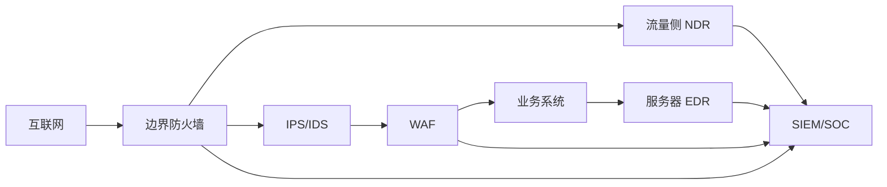

# Day 1｜一张图看懂企业安全设备部署

一句话结论：先理解设备部署在哪里、能看到什么、解决什么问题，才能把告警放回真实网络链路中分析。

## 1. 背景

企业安全不是单一设备，而是一条从互联网到业务系统的控制链。不同设备看到的流量、日志和攻击面不同，因此售前和 SOC 分析都不能只记产品名称。

## 2. 典型部署链路

## 3. 设备能力对照

| 设备 | 安装位置 | 主要解决 | 不解决 |
|---|---|---|---|
| 防火墙 | 网络边界与区域隔离 | 访问控制、分段 | 复杂 Web 攻击识别 |
| IPS | 关键链路 | 已知攻击检测和阻断 | 应用逻辑漏洞 |
| WAF | Web 入口 | SQL 注入、XSS、Webshell | 主机内部行为 |
| EDR | 终端和服务器 | 进程、账号、文件行为 | 全网络流量可见性 |
| NDR | 核心网络流量 | 横向移动、C2、异常通信 | 终端文件细节 |
| SIEM | 日志分析中心 | 多源日志关联和告警 | 主动阻断 |

## 4. 可复制检查清单

- [ ] 画出互联网到核心业务的路径；
- [ ] 标出每台设备看见的数据类型；
- [ ] 标出日志如何进入 SIEM；
- [ ] 确认告警责任人和处置流程；
- [ ] 检查是否存在日志盲区。

## 5. 我踩过的坑

- 把 IPS 和 WAF 混为一谈；
- 认为 EDR 能看到全部网络流量；
- 只画设备，不画日志流向；
- 没有区分“检测”和“阻断”。

## 6. 与告警分诊 POC 的关系

POC 从 SIEM/SOC 收到告警之后开始，不重复实现流量检测和终端检测。它负责 IOC 提取、情报富化、风险评分和处置建议。

