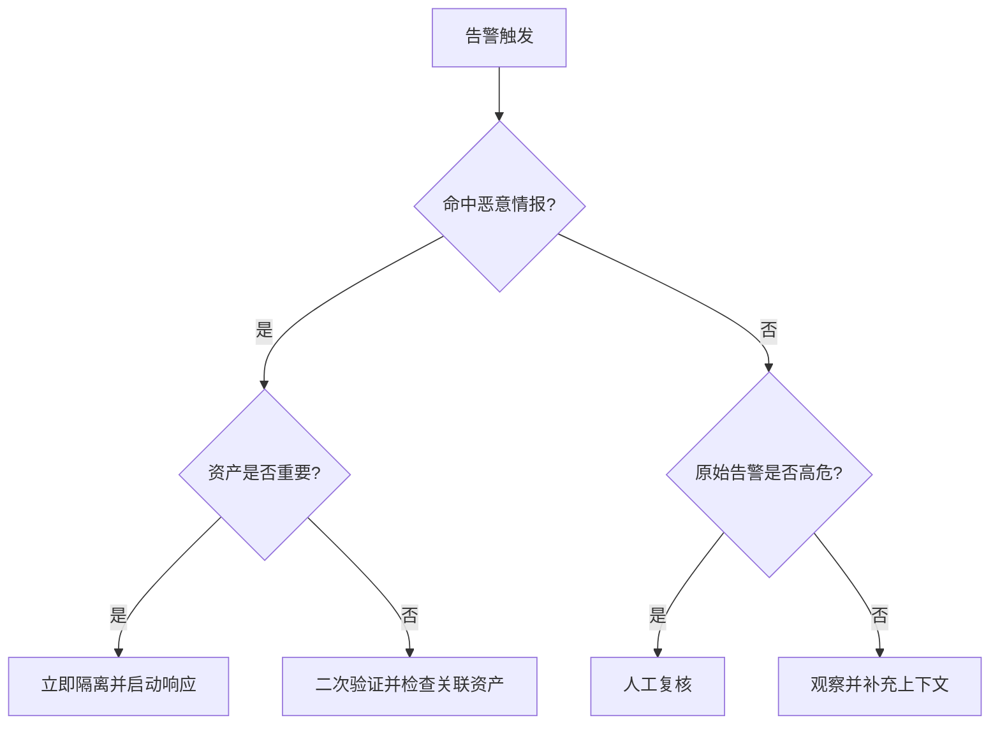

# Day 5｜威胁情报怎么用：从一条 IOC 到处置决策

一句话结论：情报命中只是证据之一，是否升级事件还要结合资产重要性、告警严重级和业务影响。

## 1. IOC 类型

| 类型 | 常见来源 | 用途 |
|---|---|---|
| IP | 防火墙、NDR、代理日志 | 判断 C2、扫描和异常外联 |
| 域名 | DNS、邮件网关 | 钓鱼、DGA 和恶意基础设施 |
| URL | WAF、代理、邮件 | 钓鱼页面和恶意下载 |
| Hash | EDR、沙箱 | 恶意文件识别 |

## 2. 决策树

## 3. 置信度怎么读

- 高置信度不等于一定攻击成功；
- 低置信度不能直接忽略；
- 情报需要结合时间窗口和资产上下文；
- 本地情报库适合 POC，生产环境需要多源交叉验证。

## 4. 与告警分诊 POC 的关系

`src/alert_triage/scoring.py` 负责把情报 verdict、置信度和标签转换为加减分，决策树就是权重设计依据。

